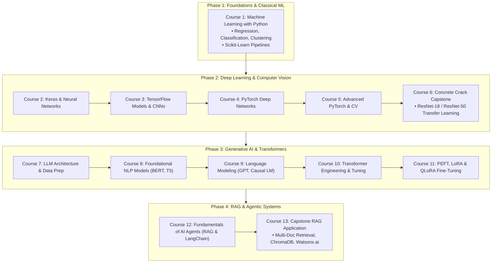

# 🎓 IBM AI Engineering Professional Study Hub & Code Repository

<div align="center">

### **🏆 Official 13-Course Specialization — 100% Grade Perfection**

[](https://www.coursera.org/account/accomplishments/specialization/2E3JMF1RRK7R)
[](https://www.credly.com/org/ibm/badge/ibm-ai-engineering-professional-certificate)
[](https://www.coursera.org/account/accomplishments/specialization/2E3JMF1RRK7R)
[](https://www.python.org/)
[](https://pytorch.org/)
[](https://huggingface.co/)
[](https://www.langchain.com/)

**Learner:** Eng. Ahmed Rifai  
**License:** Kiron Open Higher Education Coursera License  
**Comprehensive Study Guide:** [📖 Read the Complete Theoretical & Practical Study Guide](STUDY_GUIDE.md)

</div>

---

## 📌 Repository Overview

This repository serves as an exhaustive, engineering-grade study hub, reference archive, and code implementation base for the **IBM AI Engineering Professional Certificate**. It documents the end-to-end curriculum spanning classical Machine Learning, Deep Learning (Keras, TensorFlow, PyTorch), Computer Vision transfer learning, Generative AI & Transformer architectures, PEFT/LoRA fine-tuning, and Agentic RAG systems with LangChain.

> [!NOTE]
> All binary credential certificates and verification proofs are officially archived in Google Drive and verified via official Coursera credential IDs. This repository focuses strictly on high-yield technical artifacts: structured coursework, reusable Python modules in `src/`, Jupyter notebooks, and mathematical study guides.

---

## 🏗️ Architecture Blueprint



---

## 📚 Curriculum & Course Breakdown

| # | Course Title | Score | Focus Areas | Official Verification |
|:---:|:---|:---:|:---|:---:|
| **01** | Machine Learning with Python | **100%** | Regression, KNN, Decision Trees, SVM, K-Means, DBSCAN | [4FY58H3Q99S7](https://www.coursera.org/account/accomplishments/verify/4FY58H3Q99S7) |
| **02** | Intro to Deep Learning & Neural Networks with Keras | **100%** | Perceptrons, Forward/Backprop, Adam Optimizer, Keras API | [6A7KWVJM26WM](https://www.coursera.org/account/accomplishments/verify/6A7KWVJM26WM) |
| **03** | Building Deep Learning Models with TensorFlow | **100%** | CNNs, Pooling, Dropout, Batch Normalization, Autoencoders | [EVA3BAANN11I](https://www.coursera.org/account/accomplishments/verify/EVA3BAANN11I) |
| **04** | Deep Neural Networks with PyTorch | **100%** | Tensors, Autograd, Dataset/DataLoader, Optimization loops | [4JT4H81QM6EJ](https://www.coursera.org/account/accomplishments/verify/4JT4H81QM6EJ) |
| **05** | Advanced Deep Learning with PyTorch | **100%** | ResNet architectures, Transfer Learning, Feature Extraction | [ST8XULFVY8KW](https://www.coursera.org/account/accomplishments/verify/ST8XULFVY8KW) |
| **06** | AI Capstone Project with Deep Learning | **100%** | Automated Concrete Crack Detection with ResNet18 (>99% acc) | [214774P7N1O1](https://www.coursera.org/account/accomplishments/verify/214774P7N1O1) |
| **07** | Generative AI & LLMs: Architecture & Data Prep | **100%** | BPE Tokenization, Embeddings, Positional Encodings | [Y651KNK8PT23](https://www.coursera.org/account/accomplishments/verify/Y651KNK8PT23) |
| **08** | Gen AI Foundational Models for NLP | **100%** | BERT, RoBERTa, T5, Masked Language Modeling | [TUM72XL5J1HA](https://www.coursera.org/account/accomplishments/verify/TUM72XL5J1HA) |
| **09** | Generative AI Language Modeling with Transformers | **100%** | Decoder-Only Architectures, Causal Attention, Sampling (top-k/top-p) | [0PVrzapZEe6oQA6J-7B2nw](https://www.coursera.org/account/accomplishments/verify/0PVrzapZEe6oQA6J-7B2nw) |
| **10** | Generative AI Engineering & Fine-Tuning | **100%** | Instruction Tuning, Hugging Face Trainer, Compute Budgeting | [B8X9T61TLFHG](https://www.coursera.org/account/accomplishments/verify/B8X9T61TLFHG) |
| **11** | Generative AI Advanced Fine-Tuning for LLMs | **100%** | Parameter-Efficient Fine-Tuning (PEFT), LoRA, QLoRA 4-bit NF4 | [9I8AMAQKLN7P](https://www.coursera.org/account/accomplishments/verify/9I8AMAQKLN7P) |
| **12** | Fundamentals of AI Agents Using RAG & LangChain | **100%** | ChromaDB, Cosine Retrieval, LCEL Chains, Custom Agent Tools | [VN0CIRHU7WQP](https://www.coursera.org/account/accomplishments/verify/VN0CIRHU7WQP) |
| **13** | Capstone: Generative AI Applications with RAG & LangChain | **100%** | Full-Stack RAG Chatbot with Watsonx.ai & Gradio Deployment | [HTTIZHHEA2C3](https://www.coursera.org/account/accomplishments/verify/HTTIZHHEA2C3) |
| 🎓 | **Full Professional Certificate Credential** | **100%** | **IBM AI Engineering Master Credential** | [2E3JMF1RRK7R](https://www.coursera.org/account/accomplishments/specialization/2E3JMF1RRK7R) |

---

## 📂 Repository Structure

```text
├── STUDY_GUIDE.md                     # Comprehensive theoretical & mathematical study guide
├── README.md                          # Repository overview & verification index
├── .gitignore                         # Excludes cache, model weights & certificate binaries
├── src/
│   └── ibm_ai_engineering/
│       ├── __init__.py                # Package initialization
│       ├── vision_classifier.py       # PyTorch Transfer Learning & ResNet Crack Classifier
│       ├── transformer_tuning.py      # Hugging Face PEFT / LoRA tuning configuration
│       └── rag_pipeline.py            # LangChain RAG pipeline & Chroma vector retrieval
├── Machine Learning with Python/      # Course 1 Notebooks & Data
├── Introduction to Deep Learning.../  # Course 2 Keras Notebooks
├── Building Deep Learning Models.../  # Course 3 TensorFlow Labs
├── Deep Neural Networks with PyTorch/ # Course 4 PyTorch Labs
├── Deep Learning with PyTorch/        # Course 5 Advanced CV Labs
├── AI Capstone Project.../            # Course 6 Capstone Crack Detection Project
├── Generative AI and LLMs.../         # Course 7-11 GenAI & Transformer Labs
└── 12_Project_Generative_AI.../       # Course 12-13 RAG & Agentic Capstone Project
```

---

## 🚀 Quickstart & Reusable Toolkit

### Installation
```bash
git clone https://github.com/Eng-Ahmed-Rifai/IBM-AI-Engineering-Professional-Certificate.git
cd IBM-AI-Engineering-Professional-Certificate
python -m venv .venv
source .venv/bin/activate  # On Windows: .venv\Scripts\activate
pip install -r requirements.txt  # torch, torchvision, transformers, peft, langchain, chromadb
```

### 1. Vision Classifier Head Setup
```python
from ibm_ai_engineering.vision_classifier import ConcreteCrackClassifier

model = ConcreteCrackClassifier(backbone="resnet18", pretrained=True, num_classes=2)
model.freeze_backbone()  # Fine-tune only classification head
```

### 2. LoRA Fine-Tuning Setup
```python
from ibm_ai_engineering.transformer_tuning import LoRAConfigBuilder

lora_config = LoRAConfigBuilder(r=16, lora_alpha=32, target_modules=["q_proj", "v_proj"])
print(lora_config.to_dict())
```

---

## 👤 Author
**Eng. Ahmed Rifai**  
*AI & Computer Vision Engineer*  
GitHub: [@Eng-Ahmed-Rifai](https://github.com/Eng-Ahmed-Rifai)
