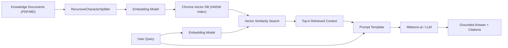

# 📖 IBM AI Engineering Professional Certificate — Comprehensive Study Guide

**Author:** Eng. Ahmed Rifai  
**Credential:** [2E3JMF1RRK7R](https://www.coursera.org/account/accomplishments/specialization/2E3JMF1RRK7R) (Verified 100% Mastery across all 13 Courses)  
**Target:** Theoretical Foundations, Mathematical Formulations, Architecture Blueprints, and Practical Code Implementations for Quick Revision and Lifelong Knowledge Preservation.

---

## 📑 Table of Contents
1. [Course 1: Machine Learning with Python](#course-1-machine-learning-with-python)
2. [Course 2: Introduction to Deep Learning with Keras](#course-2-introduction-to-deep-learning-with-keras)
3. [Course 3: Building Deep Learning Models with TensorFlow](#course-3-building-deep-learning-models-with-tensorflow)
4. [Course 4: Deep Neural Networks with PyTorch](#course-4-deep-neural-networks-with-pytorch)
5. [Course 5: Advanced Deep Learning with PyTorch (Computer Vision)](#course-5-advanced-deep-learning-with-pytorch-computer-vision)
6. [Course 6: AI Capstone Project with Deep Learning](#course-6-ai-capstone-project-with-deep-learning)
7. [Course 7: Generative AI & LLMs: Architecture & Data Preparation](#course-7-generative-ai--llms-architecture--data-preparation)
8. [Course 8: Gen AI Foundational Models for NLP](#course-8-gen-ai-foundational-models-for-nlp)
9. [Course 9: Generative AI Language Modeling with Transformers](#course-9-generative-ai-language-modeling-with-transformers)
10. [Course 10: Generative AI Engineering & Fine-Tuning Transformers](#course-10-generative-ai-engineering--fine-tuning-transformers)
11. [Course 11: Advanced Fine-Tuning for LLMs (PEFT, LoRA & QLoRA)](#course-11-advanced-fine-tuning-for-llms-peft-lora--qlora)
12. [Course 12: Fundamentals of AI Agents using RAG and LangChain](#course-12-fundamentals-of-ai-agents-using-rag-and-langchain)
13. [Course 13: Capstone Project: Generative AI Applications with RAG & LangChain](#course-13-capstone-project-generative-ai-applications-with-rag--langchain)

---

## Course 1: Machine Learning with Python

### 1. Classical Supervised Learning
- **Linear Regression**: Minimizes Mean Squared Error (MSE):
  $$\mathcal{L}_{MSE} = \frac{1}{N}\sum_{i=1}^N (y_i - \hat{y}_i)^2$$
  Solved via Ordinary Least Squares (OLS) normal equation $\theta = (X^T X)^{-1} X^T y$ or Gradient Descent.
- **Regularization**:
  - **Ridge (L2)**: Adds penalty $\lambda \sum \theta_j^2$ (prevents large weights, handles multicollinearity).
  - **Lasso (L1)**: Adds penalty $\lambda \sum |\theta_j|$ (encourages sparsity, automated feature selection).
- **Logistic Regression**: Models probabilities using the sigmoid function:
  $$\sigma(z) = \frac{1}{1 + e^{-z}}, \quad z = \theta^T x$$
  Loss function: Binary Cross-Entropy (Log Loss).
- **Classification Algorithms**:
  - **K-Nearest Neighbors (KNN)**: Non-parametric, distance metrics (Euclidean, Manhattan). Requires feature scaling.
  - **Decision Trees**: Split criteria: Information Gain (Entropy) or Gini Impurity:
    $$Gini = 1 - \sum_{i=1}^C p_i^2$$
  - **Support Vector Machines (SVM)**: Finds the maximum-margin hyperplane $w^T x + b = 0$. Uses the kernel trick (RBF, Polynomial) to project into higher-dimensional space for non-linear separation.

### 2. Unsupervised Learning & Recommender Systems
- **K-Means Clustering**: Iterative centroid optimization minimizing inertia (within-cluster sum-of-squares). Optimal $k$ determined via Elbow Method and Silhouette Score.
- **Hierarchical Clustering**: Agglomerative vs Divisive; linkage criteria: Ward, Complete, Average. Visualized via Dendrograms.
- **DBSCAN**: Density-based spatial clustering capable of finding arbitrary shapes and isolating noise/outliers (parameters: $\epsilon$ radius and `min_samples`).
- **Recommender Systems**:
  - Content-based filtering (cosine similarity between feature vectors).
  - Collaborative filtering (User-User, Item-Item, Matrix Factorization via SVD).

---

## Course 2: Introduction to Deep Learning with Keras

### 1. Artificial Neural Network (ANN) Fundamentals
- **Perceptron**: Linear combination followed by activation: $y = \phi\left(\sum w_i x_i + b\right)$.
- **Activation Functions**:
  - **ReLU**: $f(x) = \max(0, x)$ — mitigates vanishing gradient problem in deep hidden layers.
  - **Leaky ReLU**: $f(x) = \max(\alpha x, x)$ — prevents "dying ReLU".
  - **Sigmoid / Softmax**: For binary and multi-class probability output layers.
- **Forward & Backward Propagation**:
  - Forward pass computes activations across layers: $a^{[l]} = g(W^{[l]} a^{[l-1]} + b^{[l]})$.
  - Backward pass computes gradients via the Chain Rule of calculus:
    $$\frac{\partial \mathcal{L}}{\partial W^{[l]}} = \frac{\partial \mathcal{L}}{\partial a^{[l]}} \cdot \frac{\partial a^{[l]}}{\partial z^{[l]}} \cdot \frac{\partial z^{[l]}}{\partial W^{[l]}}$$
- **Optimization Algorithms**: SGD with Momentum, RMSprop, Adam (combines momentum and adaptive learning rates).

---

## Course 3: Building Deep Learning Models with TensorFlow

### 1. Convolutional Neural Networks (CNN)
- **Convolution Operation**: Feature extraction via sliding kernel filters:
  $$(I * K)(i, j) = \sum_{m} \sum_{n} I(i-m, j-n) K(m, n)$$
- **Key Hyperparameters**: Filter size ($3 \times 3, 5 \times 5$), Stride ($s$), Padding ($p$ — 'valid' vs 'same').
  Output spatial dimension:
  $$O = \left\lfloor \frac{W - F + 2P}{S} \right\rfloor + 1$$
- **Pooling Layers**: MaxPooling reduces spatial resolution while preserving dominant invariant features.
- **Regularization Techniques**: Dropout (randomly deactivating units during training), Batch Normalization (normalizing layer activations across the mini-batch to accelerate convergence).

---

## Course 4 & 5: Deep Neural Networks & Advanced CV with PyTorch

### 1. PyTorch Core Mechanics
- **Tensors & Autograd**: Computation graphs built dynamically (`requires_grad=True`). Backward pass triggered via `loss.backward()`.
- **Dataset & DataLoader**: Subclassing `torch.utils.data.Dataset` (`__len__`, `__getitem__`) with batching, shuffling, and multi-threaded loading.
- **Training Loop Anatomy**:
  ```python
  optimizer.zero_grad()
  outputs = model(inputs)
  loss = criterion(outputs, targets)
  loss.backward()
  optimizer.step()
  ```

### 2. Transfer Learning & Modern Architectures
- **Residual Networks (ResNet)**: Introduces skip/shortcut connections:
  $$\mathcal{H}(x) = \mathcal{F}(x) + x$$
  Allows gradients to flow directly through identity shortcuts, solving the vanishing/exploding gradient problem in networks with 50+ to 152 layers.
- **Strategies**:
  - **Feature Extraction**: Freeze pretrained backbone convolutional weights, train only the newly attached fully connected classification head.
  - **Fine-Tuning**: Unfreeze upper layers (or entire backbone) with a low learning rate ($10^{-5}$).

---

## Course 6: AI Capstone Project with Deep Learning

### Concrete Crack Surface Classification
- **Objective**: Automated visual inspection of concrete structures to classify surface images into positive (cracked) vs negative (non-cracked).
- **Data Pipeline**: Image resizing ($224 \times 224$), normalization using ImageNet statistics (`mean=[0.485, 0.456, 0.406]`, `std=[0.229, 0.224, 0.225]`), data augmentation (random horizontal/vertical flips, rotations).
- **Model Evaluation**:
  - Comparison between custom CNN, VGG-16, and ResNet-18/50.
  - Performance Metrics: Accuracy, Precision, Recall, F1-Score, and Confusion Matrix analysis.
  - ResNet-18 achieves $>99.8\%$ test accuracy with fast inference time.

---

## Course 7, 8 & 9: Transformer Architecture & Language Modeling

### 1. The Transformer Architecture (Vaswani et al.)
- **Self-Attention Mechanism**:
  $$\text{Attention}(Q, K, V) = \text{softmax}\left(\frac{Q K^T}{\sqrt{d_k}}\right) V$$
  - Queries ($Q$), Keys ($K$), Values ($V$) computed via linear projections: $Q = X W^Q, K = X W^K, V = X W^V$.
  - Scaling factor $\frac{1}{\sqrt{d_k}}$ prevents vanishing gradients in the softmax for high-dimensional key vectors.
- **Multi-Head Attention (MHA)**:
  Allows the model to jointly attend to information from different representation subspaces at different positions.
- **Positional Encoding**: Sinusoidal functions or learned positional embeddings inject sequence order information into the permutation-invariant self-attention layers.

### 2. Foundational LLM Paradigms
| Paradigm | Architecture | Attention Type | Primary Examples | Best Suited Tasks |
|:---|:---|:---|:---|:---|
| **Encoder-Only** | Bidirectional | Full Self-Attention | BERT, RoBERTa | Classification, NER, Sentiment Analysis |
| **Decoder-Only** | Autoregressive | Causal Masked Attention | GPT-3/4, LLaMA, Mistral | Text Generation, Code Generation, Reasoning |
| **Encoder-Decoder** | Sequence-to-Sequence | Cross-Attention | T5, BART | Summarization, Translation |

---

## Course 10 & 11: Fine-Tuning Transformers & PEFT / LoRA

### 1. Parameter-Efficient Fine-Tuning (PEFT)
Full fine-tuning of billions of parameters requires massive VRAM and risks catastrophic forgetting. PEFT freezes base weights and trains a small subset of parameters ($<1\%$).

### 2. Low-Rank Adaptation (LoRA)
- Constrains weight updates $\Delta W$ by representing them as the product of two low-rank matrices:
  $$W_{new} = W_0 + \Delta W = W_0 + \frac{\alpha}{r} (B \cdot A)$$
  where $W_0 \in \mathbb{R}^{d \times k}$, $B \in \mathbb{R}^{d \times r}$, and $A \in \mathbb{R}^{r \times k}$ with rank $r \ll \min(d, k)$.
- Matrix $A$ is initialized with Gaussian noise, and $B$ is initialized to zero, ensuring $\Delta W = 0$ at the start of training.
- **QLoRA (Dettmers et al.)**:
  - Quantizes base model weights to 4-bit NormalFloat (NF4).
  - Double Quantization to compress quantization constants.
  - Paged Optimizers to prevent memory spikes during gradient updates.

---

## Course 12 & 13: AI Agents, RAG & LangChain Applications

### 1. Retrieval-Augmented Generation (RAG) Architecture


### 2. LangChain Expression Language (LCEL)
- Declarative chain composition using pipe operator `|`:
  ```python
  chain = (
      {"context": retriever, "question": RunnablePassthrough()}
      | prompt
      | llm
      | StrOutputParser()
  )
  ```
- Modular components: `PyPDFLoader`, `CharacterTextSplitter`, `Chroma`, `HuggingFaceEmbeddings`, `WatsonxLLM`.
- Built-in conversation memory, source document citations, and web deployment via Gradio UI.
